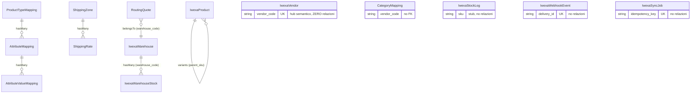

# 03 — Database

> Fonte: le 14 migration in `packages/PAYPOC/IwexaConnector/src/Database/Migrations/`
> (`2026_05_01_000001` … `000014`) e i 14 model in `src/Models/`. Tutte le righe
> citate si riferiscono al singolo file di migration.

## Premessa

Il database qui descritto è **interamente quello del package connettore**. Non
include lo schema Bagisto (prodotti, categorie, attributi, ordini, clienti): il
repository non contiene un'installazione Bagisto. Le tabelle del connettore
funzionano quindi come **staging / tracciamento**, affiancate al DB Bagisto in
un'app ospite, ma **senza vincoli di integrità verso di esso** (vedi §Criticità).

## 14 tabelle

| # | Tabella | Ruolo | Righe di logica nel model |
|---|---|---|---|
| 1 | `paypoc_iwexa_sync_jobs` | Traccia import/sync con idempotenza | lifecycle + retry |
| 2 | `paypoc_iwexa_products` | Staging prodotti + payload originale | scope + variant self-join |
| 3 | `paypoc_iwexa_stock_logs` | Audit append-only variazioni stock | **stub** (solo fillable) |
| 4 | `paypoc_iwexa_webhook_events` | Dedup consegne webhook | lifecycle + retry |
| 5 | `paypoc_category_mappings` | Mappa categoria sorgente → Bagisto | scope, **0 relazioni** |
| 6 | `paypoc_product_type_mappings` | Mappa product type → attribute family | hasMany attribute_mappings |
| 7 | `paypoc_attribute_mappings` | Mappa attributi per product type | belongsTo/hasMany |
| 8 | `paypoc_attribute_value_mappings` | Mappa valori attributo (XL→Extra Large) | near-stub |
| 9 | `paypoc_iwexa_vendors` | Anagrafica **Vendor** | scope, **0 relazioni** |
| 10 | `paypoc_iwexa_warehouses` | **Warehouse** IWEX/Vendor | hasMany stocks |
| 11 | `paypoc_iwexa_warehouse_stocks` | Stock per Warehouse | boot() calcola available_quantity |
| 12 | `paypoc_shipping_zones` | Zone di spedizione (origine→destinazione) | hasMany rates |
| 13 | `paypoc_shipping_rates` | Tariffe per zona/peso/volume | `matches()` |
| 14 | `paypoc_iwexa_routing_quotes` | Preventivi di routing (snapshot denormalizzato) | calc consegna |

Tutti i model estendono `Illuminate\Database\Eloquent\Model` **direttamente** —
nessuno estende una classe base Bagisto.

## Chiavi e vincoli

### Chiavi primarie
Tutte le tabelle usano `id` bigint auto-increment.

### Foreign key — solo 3 in tutto lo schema
| Tabella figlia | Colonna | → riferisce | On delete |
|---|---|---|---|
| `paypoc_attribute_mappings` | `product_type_mapping_id` | `paypoc_product_type_mappings(id)` | CASCADE |
| `paypoc_attribute_value_mappings` | `attribute_mapping_id` | `paypoc_attribute_mappings(id)` | CASCADE |
| `paypoc_shipping_rates` | `shipping_zone_id` | `paypoc_shipping_zones(id)` | CASCADE |

Esistono quindi **solo due catene referenziali**: la catena mapping
(product_type → attribute → attribute_value) e la catena spedizioni (zone → rate).
**Tutte le altre 9 tabelle hanno zero foreign key.**

### Vincoli UNIQUE
| Tabella | Colonne | Note |
|---|---|---|
| `sync_jobs` | `idempotency_key` | nullable (più NULL ammessi in MySQL) |
| `products` | `sku` | **dichiarato due volte** (inline + esplicito) |
| `webhook_events` | `event_id` | **dichiarato due volte** |
| `webhook_events` | `delivery_id` | **dichiarato due volte** — vedi criticità webhook |
| `product_type_mappings` | (`source_system`,`source_product_type`,`vendor_code`) | `vendor_code` nullable → NULL sfuggono al vincolo |
| `attribute_mappings` | (`product_type_mapping_id`,`source_attribute_code`) | |
| `vendors` | `vendor_code` | + indice ridondante sulla stessa colonna |
| `warehouses` | `warehouse_code` | |
| `warehouse_stocks` | (`warehouse_code`,`sku`) | |
| `shipping_zones` | (`origin_country`,`destination_country`) | |

## Relazioni Eloquent (grafo a oggetti)

Solo **tre cluster** connessi (mapping, warehouse/stock, shipping) più il self-join
varianti di `IwexaProduct`. Il resto sono **isole**: `CategoryMapping`,
`IwexaStockLog`, `IwexaSyncJob`, `IwexaVendor`, `IwexaWebhookEvent` non hanno alcuna
relazione definita.

> **`IwexaVendor` è il centro semantico del dominio** — il suo `vendor_code` compare
> come chiave esterna in almeno sei tabelle (products, warehouses, warehouse_stocks,
> category_mappings, product_type_mappings, routing_quotes) — **eppure non partecipa
> ad alcuna relazione Eloquent, in nessuna direzione, e non ha alcuna FK a livello DB.**

## Criticità

### C1 — Integrità referenziale quasi assente
`vendor_code`, `sku`, `warehouse_code` sono stringhe libere ovunque, senza FK. Un
prodotto può riferire un `vendor_code` inesistente; uno stock un `warehouse_code`
mai creato. L'unico presidio è a livello applicativo (validazione nei service), non
nel DB. Su 9 tabelle non-mapping, l'integrità è affidata al codice.

### C2 — Nessun legame con Bagisto a livello DB
`category_mappings.bagisto_category_id`, `product_type_mappings.bagisto_attribute_family_id`,
`attribute_mappings.bagisto_attribute_id` puntano a tabelle Bagisto ma **senza FK**
(sarebbero cross-package). Cancellare una categoria Bagisto lascia mapping orfani.

### C3 — Dedup webhook fragile (`delivery_id`)
`event_id` e `delivery_id` hanno **due UNIQUE a colonna singola indipendenti**, non
una UNIQUE composita `(event_id, delivery_id)`. Il model documenta dedup "per coppia"
ma il DB la impone come due vincoli separati. Combinato con il fatto che il
`WebhookController` legge l'header `X-IWEXA-DELIVERY-ID` ma **non lo inoltra** al
service (che usa invece `delivery_id` dal body JSON, vedi [04-API.md](04-API.md)), la
prima consegna priva di `delivery_id` nel body viola il vincoli NOT NULL/UNIQUE. È la
radice del bug storico "il secondo webhook fallisce sempre".

### C4 — Indici duplicati e non-standard
- `products.sku`, `webhook_events.event_id`, `webhook_events.delivery_id`: UNIQUE
  dichiarato **due volte** → due indici identici per colonna.
- `vendors.vendor_code`: UNIQUE **+** INDEX sulla stessa colonna (indice ridondante).
- Le migration 1, 2, 3, 5 chiamano `->indexed()` sulle colonne: **non è un metodo
  Blueprint standard di Laravel** (esiste `->index()`). In ogni caso le stesse colonne
  ricevono un `$table->index(...)` esplicito, quindi l'indice reale c'è; le chiamate
  `->indexed()` sono no-op o codice morto — da verificare sullo schema reale.

### C5 — Duplicazione di concetti
- **Valori attributo mappati due volte**: colonna JSON `attribute_mappings.value_mapping`
  **e** tabella relazionale `paypoc_attribute_value_mappings`. Stesso concetto in due
  forme.
- `google_product_category` compare in `category_mappings` **e** `product_type_mappings`.
  `product_type` in `products`, `category_mappings` e (come `source_product_type`) in
  `product_type_mappings`.
- Tempi prep/consegna duplicati fra `warehouse_stocks`, `shipping_rates` e
  `routing_quotes` (quest'ultima è uno snapshot denormalizzato che li riaggrega).
- `original_iwexa_payload` (blob JSON grezzo) ripetuto su products, vendors, warehouses,
  warehouse_stocks (+ `original_request_payload`/`calculated_response_payload` su routing_quotes).

### C6 — Indici mancanti su colonne di lookup naturali
`products.ean`, `products.iwexa_product_id`, `products.item_group_id` non indicizzati
benché siano chiavi esterne naturali. `stock_logs.warehouse_code`, `webhook_events.status`
e `webhook_events.received_at/processed_at` non indicizzati (solo `event_type` lo è).

### C7 — Incoerenze di tipo
- `warehouse_stocks.quantity/reserved_quantity/available_quantity` sono `integer`
  **signed** (valori negativi non impediti dal DB), mentre `stock_logs.quantity` e
  `sync_jobs.attempts` sono `unsignedInteger`.
- `vendors.country` è `string(255)`, mentre ogni altra colonna paese nello schema è
  `string(2)` ISO.
- I campi numerici quantità/peso/volume nei model non hanno `$casts` a int/float.

### C8 — Migration vendors condizionale
`000009` è l'unica avvolta in `if (! Schema::hasTable('paypoc_iwexa_vendors'))`. Le
altre 13 fanno `Schema::create` incondizionato. Suggerisce che la tabella vendors sia
stata creata anche altrove in passato.

## Colonne JSON (traceability)

`sync_jobs.payload/response`, `products.original_iwexa_payload/meta`,
`webhook_events.payload`, `attribute_mappings.validation_rules/unit_mapping/value_mapping`,
`vendors.responsible_person/original_iwexa_payload`, `warehouses.original_iwexa_payload`,
`warehouse_stocks.original_iwexa_payload`, `routing_quotes.original_request_payload/calculated_response_payload`.

L'archiviazione del payload grezzo è una scelta consapevole di tracciabilità, ma
comporta storage ridondante e rende difficili le query strutturate su quei dati.

## Verdetto DB

Schema **coerente nella forma** (naming a prefisso, tipi ragionevoli, tracciabilità),
ma con **integrità referenziale delegata quasi interamente al codice applicativo**,
alcune duplicazioni di concetto e almeno un vincolo (webhook `delivery_id`) coinvolto
in un bug reale. È uno schema da **staging/prototipo**, non da sistema transazionale
maturo. Nessuna tabella per **ordini**, **wallet**, **crediti**, **pagamenti**: quei
domini non esistono nel DB.
</content>
